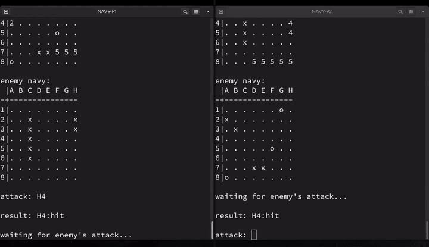
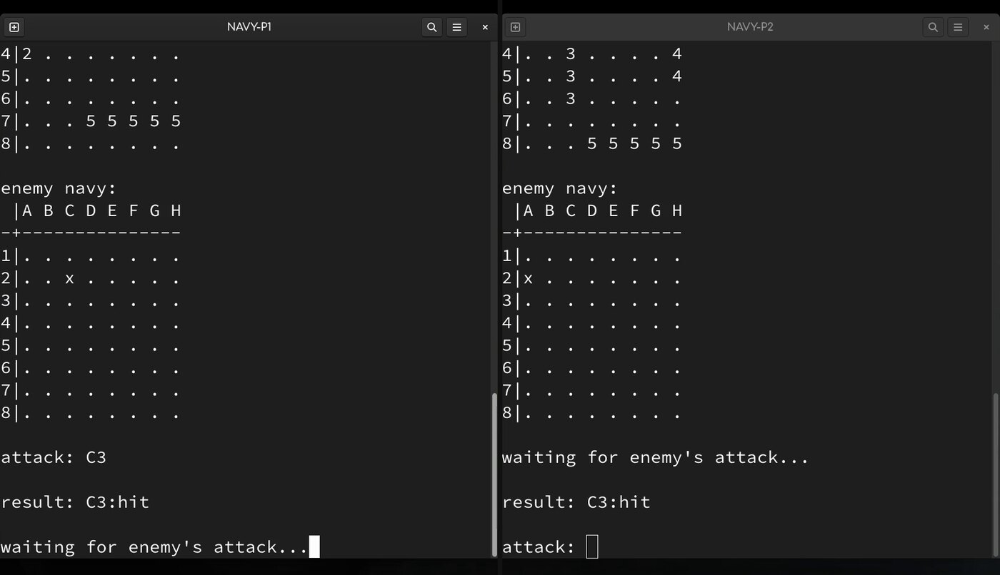
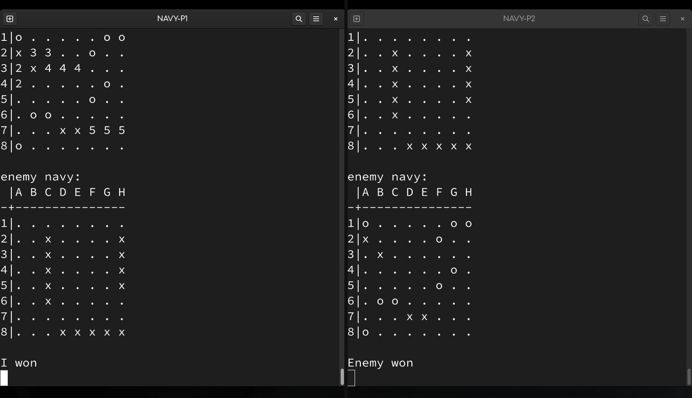

# my_navy — bataille navale par signaux UNIX (Epitech, 1re année)

> **EN** — Battleship for two terminals, written in C (Epitech, Jan. 2024, team of 2). The two processes talk
> **only through UNIX signals** (`SIGUSR1` / `SIGUSR2`): every shot, every hit or miss is encoded as a burst of signals.

**my_navy** est une bataille navale jouée dans deux terminaux. La particularité du sujet Epitech : les deux
programmes n'ont pas le droit d'utiliser de réseau, de fichier partagé ou de tube. Ils ne communiquent **qu'avec
deux signaux**, `SIGUSR1` et `SIGUSR2`. Il faut donc inventer un petit protocole pour faire passer une case
(« C4 ») et sa réponse (touché / manqué) avec seulement deux « bits ».

| En jeu | Fin de partie |
| --- | --- |
|  |  |

🎬 Vidéo d'une partie complète (accélérée ×2) : [media/gameplay.mp4](media/gameplay.mp4)

## Déroulement

1. Le joueur 1 lance `./my_navy pos1` : le programme affiche son PID et attend.
2. Le joueur 2 lance `./my_navy <pid du joueur 1> pos2` : il envoie un premier signal, et le joueur 1 récupère son PID dans `siginfo_t` (`SA_SIGINFO`).
3. Chacun voit sa flotte (`my navy`) et ses tirs (`enemy navy`). À tour de rôle, on tape une case (`A1` à `H8`).
4. `x` = touché, `o` = manqué. Le premier qui coule les 4 navires adverses (tailles 2 à 5) affiche « I won », l'autre « Enemy won ».

Les flottes sont décrites dans un fichier par navire : `taille:début:fin`, par exemple `3:A2:C2`.
Le fichier est validé : format, et un navire de chaque taille de 2 à 5 (sinon le programme s'arrête avec le code 84).

## Le protocole

| Message | Signaux |
| --- | --- |
| Connexion | joueur 2 → joueur 1 : `SIGUSR1` (le PID voyage avec le signal) |
| Tir sur la colonne *c*, ligne *l* | *c* × `SIGUSR1`, `SIGUSR2`, *l* × `SIGUSR1`, `SIGUSR2` |
| Réponse | `SIGUSR1` = touché, `SIGUSR2` = manqué |
| État après le tour | `SIGUSR2` puis `SIGUSR1` = la partie continue ; deux signaux identiques = partie terminée |

Les signaux sont comptés dans un gestionnaire (`signal` / `sigaction`) ; une courte pause (`usleep`) entre deux
envois évite que le noyau fusionne des signaux identiques encore en attente.

## Technique

- C, norme de code Epitech, ~600 lignes, avec notre propre `my_printf` en bibliothèque statique (`lib/my`).
- Appels système : `kill`, `sigaction` (`SA_SIGINFO`), `signal`, `pause`, `getpid`, `usleep`.
- Fichiers : `connection.c` (connexion et tour de jeu), `convert_signal.c` (réception), `events.c` (envoi des tirs et des réponses),
  `readfile.c` (lecture et validation des flottes), `end_function.c` (fin de partie).

Installation : [docs/INSTALL-fedora.md](docs/INSTALL-fedora.md)

## Mon rôle

Projet en **binôme** (janvier 2024). Mon coéquipier a posé la connexion entre les deux processus et la
bibliothèque ; de mon côté j'ai écrit la lecture et la validation des fichiers de flotte, l'encodage et le décodage
des tirs en signaux, la gestion des tirs (touché / manqué), la fin de partie et les corrections finales
(norme de code, suppression de `stat`).

## Code source

Le code source et son historique complet sont dans un dépôt privé :
[FuniclemDev/navy-source](https://github.com/FuniclemDev/navy-source) (accès sur demande).
Ce dépôt public ne contient que la présentation, la documentation et les médias : le code des projets Epitech
n'est pas publié en accès libre.

---
Clément Dorge · [clementdorge.com](https://clementdorge.com/fr/projets/navy/) · Epitech Strasbourg
